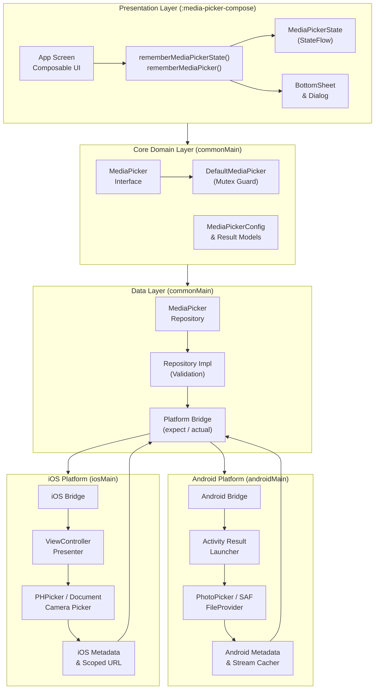
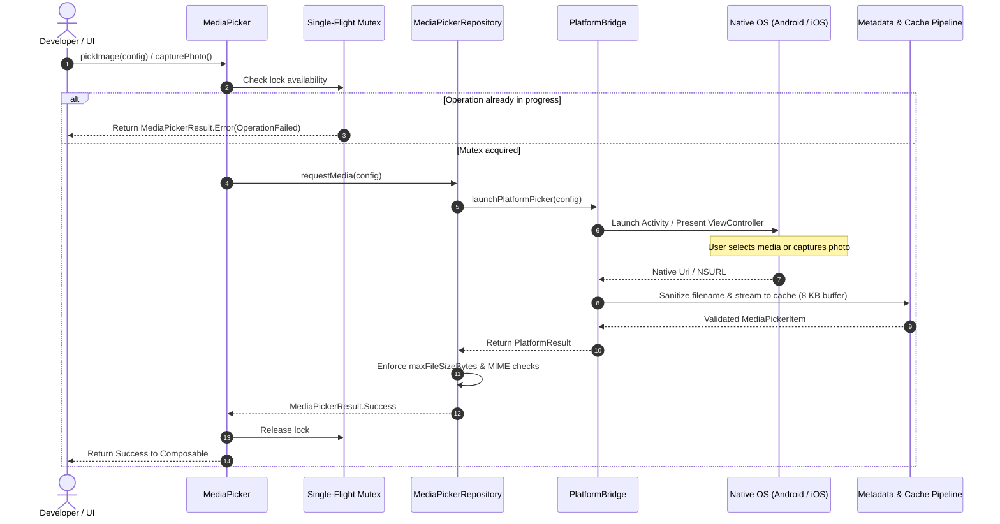

# MediaPickerKMP

A Production-Ready Media Picker Library for Kotlin Multiplatform.

MediaPickerKMP is a unified, lifecycle-safe media and file picker for **Android** and **iOS**, with first-class support for **Compose Multiplatform**. It abstracts native platform pickers (Android Photo Picker, Storage Access Framework, PHPicker, UIDocumentPicker, and UIImagePickerController) into a clean, reactive Kotlin API.

---

## Features

- **Images & Photos**: Single and multiple photo selection using modern native system pickers (AndroidX Photo Picker, iOS PHPicker).
- **Videos**: Single and multiple video selection with duration and dimension extraction.
- **Audio Files**: Single and multiple audio selection with duration extraction using native frameworks.
- **Documents & Files**: PDF, DOCX, TXT, and custom MIME types with security-scoped resource handling on iOS.
- **Camera Capture**: Integrated camera photo capture using Android `FileProvider` and iOS `UIImagePickerController`.
- **Compose Multiplatform**: `rememberMediaPicker()` and `rememberMediaPickerState()` composables, with ready-to-use Material 3 BottomSheets and Dialogs.
- **Security-Hardened**: Built-in path traversal defense, canonical path containment checks, and robust MIME type normalization.
- **Memory Efficient**: Streaming copy-to-cache pipeline prevents OutOfMemory errors on large assets.
- **Concurrency Safe**: Mutex-based single-flight operation model prevents overlapping picker launches.

---

## Supported Platforms

| Platform | Minimum Target | Implementation Mechanism |
| :--- | :--- | :--- |
| **Android** | API 24 (Android 7.0+) | AndroidX Photo Picker, SAF OpenDocument, FileProvider |
| **iOS** | iOS 14.0+ | PHPickerViewController, UIDocumentPicker, UIImagePicker |
| **Compose** | Compose Multiplatform 1.7+ | Material 3 Composables, reactive StateFlow UI State |

---

## Platform Feature Compatibility

| Feature | Android | iOS | Notes |
| :--- | :---: | :---: | :--- |
| Single Image | Yes | Yes | Photo Picker / PHPicker |
| Multiple Images | Yes | Yes | Configurable selection limit |
| Single Video | Yes | Yes | Extracts dimensions & duration |
| Multiple Videos | Yes | Yes | Streams large files |
| Single Audio | Yes | Yes | SAF / UIDocumentPicker |
| Multiple Audio | Yes | Yes | Supports MP3, WAV, AAC, FLAC, etc. |
| Documents | Yes | Yes | Custom MIME / UTType filtering |
| Camera Photo Capture | Yes | Yes | Requires camera hardware |
| Copy to Cache | Yes | Yes | App-private storage |
| Max File Size Filter | Yes | Yes | Client-side validation |

---

## End-to-End Performance & Execution Flow

Below is the complete execution pipeline showing how MediaPickerKMP processes any media request from the UI down to native system APIs and back:

```
[ User UI / Composable ]
          │
          │ 1. Calls picker.pickImage() / capturePhoto()
          ▼
[ MediaPickerState / DefaultMediaPicker ]
          │
          │ 2. Single-Flight Mutex: Blocks overlapping concurrent calls
          ▼
[ MediaPickerRepositoryImpl ]
          │
          │ 3. Delegates to Platform Bridge
          ▼
[ PlatformMediaPickerBridge (expect / actual) ]
          │
          ├────────────────────────┬────────────────────────┐
          ▼                        ▼                        ▼
  [ Android ActivityResult ]   [ iOS PHPicker ]   [ iOS Camera / Document ]
          │                        │                        │
          │ User picks / captures  │ User picks in Photos   │ User captures / selects
          ▼                        ▼                        ▼
  [ Android Content URI ]      [ iOS PHPickerResult ]   [ iOS NSURL / File ]
          │                        │                        │
          └────────────────────────┴────────────────────────┘
                                   │
                                   │ 4. Platform Metadata Extraction & Caching
                                   ▼
                   [ Android / iOS Metadata Extractor ]
                     - Filename sanitization (Path traversal defense)
                     - Fixed 8 KB buffer streaming to cache (OOM safe)
                     - Duration, dimensions, MIME type, file size extraction
                                   │
                                   │ 5. Returns validated MediaPickerItem
                                   ▼
                   [ Repository Validation Layer ]
                     - Max file size check
                     - MIME type filtering & normalization
                                   │
                                   │ 6. Emits MediaPickerResult.Success
                                   ▼
                   [ Compose UI Recomposition ]
```

### Key Performance Guarantees

1. **Single-Flight Operation Mutex**: If a user double-taps or triggers multiple picker actions simultaneously, `DefaultMediaPicker` guards execution using a coroutine `Mutex`. Extra concurrent calls are immediately rejected with `MediaPickerError.OperationFailed` rather than causing corrupt state or duplicate dialogs.
2. **Zero-OOM File Streaming**: Files are copied from system `ContentResolver` or iOS `NSURL` using a fixed 8 KB buffer. Memory usage remains constant (~8 KB) even when copying 4K videos or gigabyte-sized audio files.
3. **Path Traversal Protection**: All filenames returned by external content providers are sanitized through `AndroidMetadataExtractor.sanitizeFileName()`. Traversal elements (`../`, `..\`), path separators, and illegal characters are stripped, and canonical target paths are strictly verified to remain within app-private cache boundaries.

---

## Architecture Overview

MediaPickerKMP adheres to Clean Architecture and MVVM principles across Kotlin Multiplatform targets:



### End-to-End Sequence & Execution Flow



See [docs/ARCHITECTURE.md](docs/ARCHITECTURE.md) for architectural details.

---

## Module Structure

```
MediaPickerKMP/
├── media-picker/              # Core KMP library (Android & iOS)
├── media-picker-compose/      # Compose Multiplatform UI & state
└── sample/                    # Showcase Android & iOS Compose app
```

---

## Installation

### 1. Repository Setup

Add JitPack to your `settings.gradle.kts`:

```kotlin
dependencyResolutionManagement {
    repositories {
        google()
        mavenCentral()
        maven { url = uri("https://jitpack.io") }
    }
}
```

### 2. Dependency Declaration

In your module's `build.gradle.kts`:

```kotlin
kotlin {
    sourceSets {
        commonMain.dependencies {
            // Core media picker API
            implementation("com.github.gargpadmakar.MediaPickerKMP:media-picker:1.0.0")

            // Compose Multiplatform integration (optional)
            implementation("com.github.gargpadmakar.MediaPickerKMP:media-picker-compose:1.0.0")
        }
    }
}
```

---

## Platform Setup

### Android Setup

In your `AndroidManifest.xml`, configure a `FileProvider` for camera capture:

```xml
<manifest xmlns:android="http://schemas.android.com/apk/res/android">
    <uses-feature android:name="android.hardware.camera" android:required="false" />

    <application>
        <provider
            android:name="androidx.core.content.FileProvider"
            android:authorities="${applicationId}.mediapicker.fileprovider"
            android:exported="false"
            android:grantUriPermissions="true">
            <meta-data
                android:name="android.support.FILE_PROVIDER_PATHS"
                android:resource="@xml/media_picker_file_paths" />
        </provider>
    </application>
</manifest>
```

Create `res/xml/media_picker_file_paths.xml`:

```xml
<?xml version="1.0" encoding="utf-8"?>
<paths xmlns:android="http://schemas.android.com/apk/res/android">
    <cache-path name="media_picker_cache" path="media_picker_cache/" />
    <cache-path name="camera_captures" path="camera_captures/" />
</paths>
```

For complete Android details, see [docs/ANDROID_SETUP.md](docs/ANDROID_SETUP.md).

### iOS Setup

In your iOS `Info.plist`, declare permission usage strings:

```xml
<key>NSCameraUsageDescription</key>
<string>This app requires camera access to take photos.</string>
<key>NSPhotoLibraryUsageDescription</key>
<string>This app requires access to your photo library to select media.</string>
```

For complete iOS details, see [docs/IOS_SETUP.md](docs/IOS_SETUP.md).

---

## Basic Usage

### Using with Compose Multiplatform

```kotlin
import androidx.compose.runtime.Composable
import androidx.compose.runtime.rememberCoroutineScope
import io.github.padmakargarg.mediapicker.compose.rememberMediaPicker
import io.github.padmakargarg.mediapicker.domain.model.MediaPickerConfig
import io.github.padmakargarg.mediapicker.domain.model.MediaPickerResult
import kotlinx.coroutines.launch

@Composable
fun MediaScreen() {
    val picker = rememberMediaPicker()
    val scope = rememberCoroutineScope()

    Button(onClick = {
        scope.launch {
            when (val result = picker.pickImage()) {
                is MediaPickerResult.Success -> {
                    val item = result.data
                    println("Selected: ${item.name}, size: ${item.sizeInBytes} bytes, uri: ${item.uri}")
                }
                is MediaPickerResult.Cancelled -> println("User cancelled picker")
                is MediaPickerResult.Error -> println("Picker failed: ${result.error.message}")
            }
        }
    }) {
        Text("Select Image")
    }
}
```

---

## Media Selection Examples

### Single & Multiple Image Selection

```kotlin
// Single Image
val singleResult = picker.pickImage()

// Multiple Images (up to 5)
val multipleResult = picker.pickMultipleImages(
    config = MediaPickerConfig.multiple(maxSelection = 5)
)
```

### Video Selection

```kotlin
val videoResult = picker.pickVideo()
if (videoResult is MediaPickerResult.Success) {
    val video = videoResult.data
    println("Video: ${video.name}, duration: ${video.durationMs}ms, dimensions: ${video.width}x${video.height}")
}
```

### Audio Selection

```kotlin
val audioResult = picker.pickAudio(
    config = MediaPickerConfig(
        allowedMimeTypes = listOf("audio/mpeg", "audio/wav", "audio/mp4")
    )
)
```

### Document Selection

```kotlin
val docResult = picker.pickDocument(
    config = MediaPickerConfig(
        allowedMimeTypes = listOf("application/pdf", "text/plain")
    )
)
```

### Camera Photo Capture

```kotlin
val photoResult = picker.capturePhoto()
if (photoResult is MediaPickerResult.Success) {
    println("Captured photo at: ${photoResult.data.localPath}")
}
```

---

## Configuration Options

Configure behavior via `MediaPickerConfig`:

```kotlin
val config = MediaPickerConfig(
    maxSelection = 10,                          // Maximum items for multiple selection
    allowedMimeTypes = listOf("image/jpeg", "image/png"), // Filter MIME types
    maxFileSizeBytes = 10 * 1024 * 1024L,       // 10 MB limit per file
    copyToCache = true,                         // Copy to app-private cache directory
    extractMetadata = true,                     // Extract dimensions and duration
    compressionQuality = 75,                    // Image quality (1-100)
    maxImageWidth = 1920,                       // Downscale width if exceeded
    maxImageHeight = 1080                       // Downscale height if exceeded
)
```

### Image Compression & Resizing
Set `compressionQuality` (1 to 100), `maxImageWidth`, and `maxImageHeight` to automatically compress high-resolution camera or gallery images down to lightweight JPEG files with optimized dimensions without running out of memory.

```kotlin
// Example: Compress picked image to 70% quality, max 1080px
val compressedConfig = MediaPickerConfig.single(
    copyToCache = true,
    compressionQuality = 70,
    maxImageWidth = 1080,
    maxImageHeight = 1080
)
val result = picker.pickImage(compressedConfig)
```

### MIME Type Normalization
MIME matching automatically normalizes parameters, whitespace, and case:
- `"APPLICATION/PDF"` matches `"application/pdf"`
- `"application/pdf; charset=utf-8"` matches `"application/pdf"`
- Wildcards are supported: `"image/*"`, `"audio/*"`, `"video/*"`, `"*/*"`

---

## Reactive UI with `rememberMediaPickerState`

For complete UI state handling with prebuilt dialogs and bottom sheets:

```kotlin
@Composable
fun FullMediaScreen() {
    val state = rememberMediaPickerState()

    Column {
        Button(onClick = { state.launchPickImage() }) {
            Text("Select Image")
        }

        when (val ui = state.uiState) {
            is MediaPickerUiState.Idle -> Text("Idle")
            is MediaPickerUiState.Loading -> CircularProgressIndicator()
            is MediaPickerUiState.Success -> SelectedMediaList(items = ui.items)
            is MediaPickerUiState.Cancelled -> Text("Selection was cancelled")
            is MediaPickerUiState.Error -> Text("Error: ${ui.error.message}")
        }
    }
}
```

See [docs/COMPOSE_USAGE.md](docs/COMPOSE_USAGE.md) for more details.

---

## Security Considerations

1. **Path Traversal Defense**: External filenames are sanitized by stripping path separators, `../`, and `..\`. Canonical path boundaries are strictly verified before writing to cache.
2. **Private Storage**: All cached files are placed in app-private directories.
3. **Resource Access**: Security-scoped iOS URLs are accessed through scoped coordination and closed in `finally` blocks.

See [docs/SECURITY.md](docs/SECURITY.md) for more details.

---

## Testing

MediaPickerKMP includes unit tests across `commonTest`, `androidHostTest`, and `iosTest`:

```bash
# Run all multiplatform tests
./gradlew :media-picker:allTests :media-picker-compose:allTests

# Assemble sample app
./gradlew :sample:assembleDebug
```

---

## Known Limitations

- **iOS Simulator Camera**: The iOS Simulator lacks camera hardware. `capturePhoto()` returns `MediaPickerError.OperationFailed` on simulators. Use a physical iOS device to test camera capture.
- **Android SAF Permissions**: URIs returned by SAF document picker may require persistable permission grants if accessed across process restarts; copying to cache (`copyToCache = true`, default) is recommended.

---

## Contributing

Contributions, bug reports, and suggestions are welcome! Please open an issue or submit a pull request on GitHub.

---

## License

MediaPickerKMP is released under the [Apache License 2.0](LICENSE).

---

## Author

**Padmakar Garg**  
GitHub: [@gargpadmakar](https://github.com/gargpadmakar)
