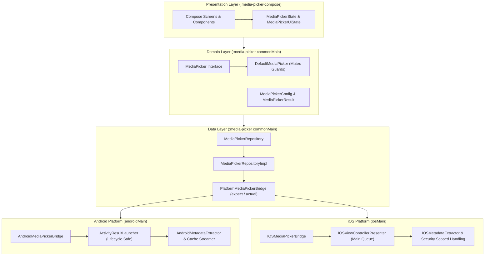

# Architecture Overview

MediaPickerKMP adheres to Clean Architecture and MVVM principles across Kotlin Multiplatform targets.

## Layer Structure

## Core Design Principles

1. **Platform Independence**: `commonMain` contains zero platform-specific types.
2. **Single-Flight Operation Mutex**: `DefaultMediaPicker` guards all pick operations using a coroutine mutex. Overlapping requests immediately fail with `MediaPickerError.OperationFailed` rather than corrupting state.
3. **Stream-Based I/O**: Files copied to cache are streamed with fixed buffers (8 KB), ensuring constant memory usage even with gigabyte-sized video or audio files.
4. **Lifecycle-Safe Presentation**: Android uses `ActivityResultLauncher` registered on Activity creation or Composable composition. iOS uses `IOSViewControllerPresenter` to present over the active `UIWindowScene` on the main queue with immediate failure fallback if no window is active.
